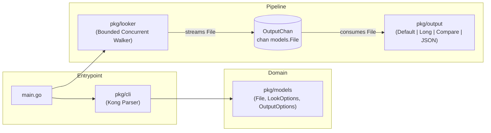

# Architecture Guide

This document describes the internal design, package layout, and concurrency model of `go-ls`.

---

## High-Level Overview

`go-ls` uses a streaming **producer-consumer pipeline** connected by a buffered Go channel (`models.OutputChan`):

1. **CLI Layer (`main.go` & `pkg/cli`)**: Parses command-line flags using [`github.com/alecthomas/kong`](https://github.com/alecthomas/kong) and translates them into domain option structs (`models.LookOptions` and `models.OutputOptions`).
2. **Producer (`pkg/looker`)**: Walks target files and directories concurrently, collects file metadata (`os.FileInfo`, owner/group, timestamps), optionally computes file checksums (`crc32` or `sha256`), and streams `models.File` values onto the output channel.
3. **Consumer (`pkg/output`)**: Reads `models.File` records from the channel as they arrive and renders them immediately to `os.Stdout` (or any `io.Writer`) in the selected format (`default`, `long`, `compare`, or `json`).



---

## Package Structure & Dependency Rules

```text
go-ls/
├── main.go                 # Application entrypoint
├── pkg/
│   ├── models/             # Pure domain models & option types (no internal imports)
│   │   ├── file.go         # File struct, UID/GID cache, timestamps, checksums, JSON marshaling
│   │   ├── file_test.go
│   │   └── options.go      # LookOptions, OutputOptions, HashAlgorithm, OutputFormat
│   ├── cli/                # Command-line flag definitions & option builders
│   │   ├── cli.go          # CLI struct and ToLookOptions / ToOutputOptions
│   │   ├── cli_test.go
│   │   └── constants.go    # Version and date formatting constants
│   ├── looker/             # Concurrent directory walker & file hasher
│   │   ├── looker.go       # Run, Look, bounded worker semaphore
│   │   └── looker_test.go
│   └── output/             # Output controller and console/CSV/JSON formatters
│       ├── controller.go   # Output and WriteOutput stream dispatcher
│       ├── console.go      # Default, List, Comparable (CSV), and JSON formatters
│       └── output_test.go
└── docs/                   # Project documentation
```

### Dependency Direction

- `pkg/models` sits at the bottom of the dependency graph and **must not** import any other internal package.
- `pkg/cli`, `pkg/looker`, and `pkg/output` depend on `pkg/models`.
- `main.go` wires `pkg/cli`, `pkg/looker`, and `pkg/output` together.

---

## Concurrency & Resource Management

### Bounded Semaphore (`sem chan struct{}`)

Unbounded goroutine recursion on deep directory trees can easily exhaust operating system file descriptors (`EMFILE: too many open files`). `pkg/looker` prevents this while maintaining high throughput:

- A buffered channel `sem := make(chan struct{}, workers)` limits concurrent I/O operations (`os.ReadDir` and `File.ComputeHash`) to `--workers` (defaults to `max(runtime.NumCPU(), 4)`).
- Semaphore tokens are held **only** for the duration of an individual `os.ReadDir` or `ComputeHash` call and are **never** held while waiting on recursive subdirectories or sending to `OutputChan`. This guarantees the traversal is completely deadlock-free regardless of directory depth.

### Directory Merkle Hashing

When `--hash` (or `--compare`) is enabled, `pkg/looker` computes a deterministic hash for every directory (`File.ComputeDirHash`) by combining the hashes of its child entries in sorted (`os.ReadDir`) order. Any modification to a nested file or subdirectory propagates up the tree and changes the parent directory's hash.

### In-Memory UID/GID Caching

Looking up usernames and group names via `os/user.LookupId` and `os/user.LookupGroupId` on every file in a large tree incurs heavy overhead. `models.File.FillOwnerAndGroup()` caches resolved `user.User` and `user.Group` structs in thread-safe `sync.Map` instances (`uidCache` and `gidCache`).
