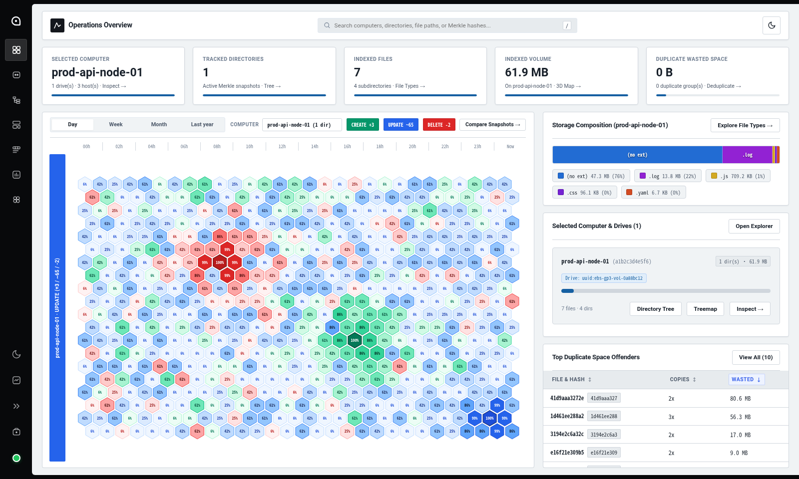

# `go-ls` Project Documentation

Welcome to the official documentation for **`go-ls`** (`github.com/vitorecomp/go-ls`), a concurrent directory scanning, Merkle-tree hashing, live filesystem monitoring, backup comparison, and duplicate detection platform written in Go with an integrated Next.js web console.

---

## Documentation Index

| Document | Description |
| :--- | :--- |
| [**Architecture (`architecture.md`)**](./architecture.md) | End-to-end system topology, package structure, client-server communication, concurrent directory traversal, and live filesystem event monitoring. |
| [**Data Model & Storage (`data-model.md`)**](./data-model.md) | Domain models (`Computer`, `ScanRecord`, `ScanSummary`, `ScanEntry`, `ScanHistoryEntry`, `DiffReport`, `DuplicateGroup`), PostgreSQL schema, ER diagrams, and REST API payloads. |
| [**Design Decisions (`design.md`)**](./design.md) | Deep dive into Merkle directory hashing, hardware/volume UUID detection (`DetectDriveID`), in-place snapshot versioning with revision history, and deadlock-free worker concurrency. |
| [**Roadmap & TODO (`todo.md`)**](./todo.md) | Completed engineering milestones and prioritized backlog of upcoming features and optimizations. |
| [**Usage & Recipes (`usage.md`)**](./usage.md) | CLI command reference, `--live` monitoring workflows, Podman/Docker Compose deployment, and Next.js Web Console guide. |
| [**Contributing (`contributing.md`)**](./contributing.md) | Local development setup, build/test/verification commands, and architectural conventions. |
| [**Visual References (`references/`)**](./references/) | UI/UX design inspiration and reference assets for the web console. |
