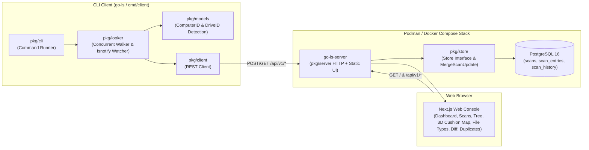
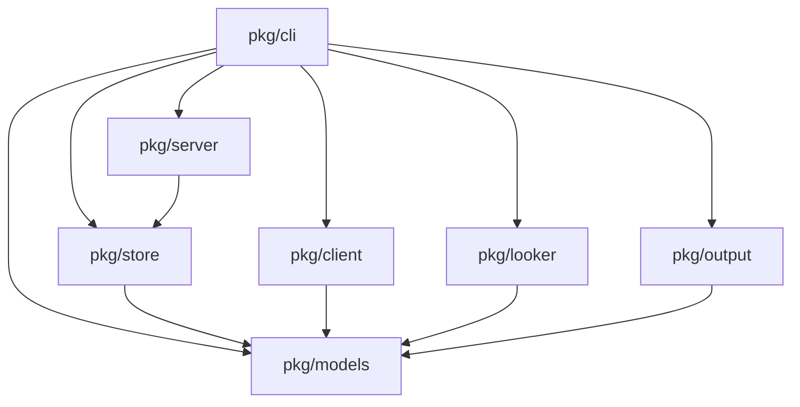
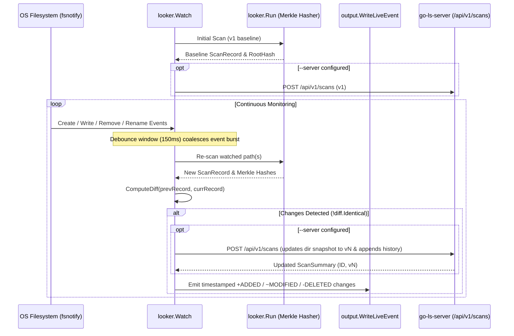

# Architecture Guide

This document describes the client-server architecture, Next.js frontend integration, package boundaries, REST API, concurrency model, and live filesystem monitoring pipeline of `go-ls`.

---

## 1. High-Level System Overview

`go-ls` is structured as a modular **client-server platform with an embedded Next.js web console**:

1. **Client (`go-ls [scan]`, `go-ls scans`, `go-ls diff`, `go-ls duplicates`, or `cmd/client`)**:
   - Traverses local filesystems concurrently using a bounded worker semaphore (`pkg/looker`).
   - Computes file content digests (`crc32` or `sha256`) and bottom-up directory Merkle hashes (`pkg/models`).
   - Identifies the host **Computer** (`/etc/machine-id` / hostname) and the underlying **Hard Drive / Volume** (`uuid:...`, `partuuid:...`, `diskid:...`, `fsid:...`, or `dev:...`).
   - Supports continuous live directory monitoring (`--live` via `fsnotify` in `pkg/looker/watch.go`), debouncing rapid filesystem events and emitting incremental diffs (`+ [ADDED]`, `~ [MODIFIED]`, `- [DELETED]`).
   - Streams entries to the local console (`pkg/output`) and/or uploads snapshots to the server via `pkg/client`.
2. **Server (`go-ls serve` or `cmd/server`)**:
   - Serves the compiled Next.js static export (`web/out` or `/usr/local/share/go-ls/web`) on `/` and exposes a JSON REST API under `/api/v1/*` and `/healthz` (`pkg/server`).
   - Organizes snapshots under their parent **Computer** and **Drive ID**.
   - Updates existing directory snapshots in place (`v1`, `v2`, ...) when the same `(computer_id, drive_id, root_path)` is re-scanned, while preserving the complete revision & diff history (`scan_history`).
   - Supports both PostgreSQL (`pkg/store/postgres.go`) and a thread-safe in-memory store (`pkg/store/memory.go`).
3. **Next.js Web Console (`web/`)**:
   - Static Next.js application (`output: 'export'`) styled with Vanilla CSS (`web/app/globals.css`).
   - Provides seven interactive views in a fixed dark sidebar layout: **Operations Overview Dashboard** (`dashboard`), **Computers & Scans** (`scans`, with toggleable **Current Files** and **Change History**), **Directory Tree** (`tree`, WinDirStat hierarchical folder breakdown), **3D Cushion Map** (`treemap`, 3D Isometric Cushion Map), **File Types** (`filetypes`, extension storage distribution), **Snapshot Diff** (`diff`), and **Duplicates** (`duplicates`).



---

## 2. Repository & Package Layout

```text
go-ls/
├── main.go                 # Unified CLI entrypoint (scan, scans, diff, duplicates, serve)
├── cmd/
│   ├── server/main.go      # Dedicated server binary entrypoint (used in Containerfile/Dockerfile)
│   └── client/main.go      # Dedicated client binary entrypoint
├── web/                    # Next.js frontend application (static export served by pkg/server)
│   ├── app/
│   │   ├── layout.js       # Root HTML layout & typography
│   │   ├── globals.css     # Vanilla CSS design system
│   │   └── page.js         # 7-view console (Dashboard, Scans, Directory Tree, 3D Cushion Map, File Types, Diff, Duplicates)
│   ├── next.config.mjs     # Static export configuration (output: 'export', distDir: 'out')
│   └── package.json
├── Containerfile           # Multi-stage Podman build (Node 22 web-builder + Go 1.24 builder + Alpine)
├── Dockerfile              # Multi-stage Docker build (Node 22 web-builder + Go 1.24 builder + Alpine)
├── podman-compose.yml      # Rootless Podman Compose production stack (PostgreSQL 16 + go-ls-server)
├── podman-compose.dev.yml  # Rootless Podman Compose hot-reload dev stack (Go fsnotify + Next.js HMR)
├── docker-compose.yml      # Docker Compose production stack (PostgreSQL 16 + go-ls-server)
├── docker-compose.dev.yml  # Docker Compose hot-reload dev stack (Go fsnotify + Next.js HMR)
├── PRODUCT.md              # Product definition, capabilities, and visual reference commitments
├── DESIGN.md               # Design system specification ("The Isometric Hardware Telemetry Deck")
├── .impeccable/design.json # Machine-readable design tokens and component rules
├── scripts/                # Helper utilities (seed-fake-data.sh and scripts/seed/main.go)
├── pkg/
│   ├── models/             # Pure domain models, Merkle hashing, ComputerID & DriveID detection
│   ├── looker/             # Bounded concurrent directory walker & fsnotify live watcher
│   ├── output/             # Local console formatters & client-server report formatters
│   ├── store/              # Storage abstraction (Store interface, PostgresStore, MemoryStore)
│   ├── server/             # HTTP REST API handlers + Next.js static file server & HMR reverse proxy
│   ├── client/             # HTTP client for interacting with the server API
│   └── cli/                # Kong command structs, argument normalization, command runners, and dev supervisor
└── documents/              # Project documentation (architecture, data model, design, todo, usage, contributing)
```

### Package Dependency Graph

`pkg/models` is the foundational layer and has **zero** internal imports:



---

## 3. HTTP REST API Endpoints (`pkg/server`)

| Method | Path | Description |
| :--- | :--- | :--- |
| `GET` | `/` | Serves the compiled Next.js static frontend (`web/out` or `/usr/local/share/go-ls/web`). |
| `GET` | `/healthz` | Healthcheck endpoint returning `{"status":"ok"}`. |
| `GET` | `/api/v1/computers` | Lists all tracked computers (`[]models.Computer`), their drive IDs, and their directory snapshots. |
| `POST` | `/api/v1/scans` | Creates or updates a full directory snapshot under its `(computer_id, drive_id, root_path)`, records the revision diff in its history, and returns `201 Created` with `models.ScanSummary`. |
| `POST` | `/api/v1/scans/batch` | Appends or upserts an incremental batch of scan entries (`models.ScanBatchRequest`), finalizing the Merkle root hash and revision history when `final: true`. |
| `GET` | `/api/v1/scans` | Lists all active directory snapshots (`[]models.ScanSummary`) ordered newest update first. |
| `GET` | `/api/v1/scans/{id}` | Retrieves a full `models.ScanRecord` (summary + current entries + change history) by ID. |
| `GET` | `/api/v1/scans/{id}/history` | Retrieves the revision and diff history (`[]models.ScanHistoryEntry`) for a tracked directory. |
| `GET` | `/api/v1/diff?base={id1}&target={id2}` | Compares two directory snapshots by relative path and returns a `models.DiffReport`. |
| `GET` | `/api/v1/duplicates?scan_id={optional}` | Finds duplicate files by `(hash, size)` within a scan or across all scans. |

---

## 4. Live Monitoring Pipeline (`--live`)


