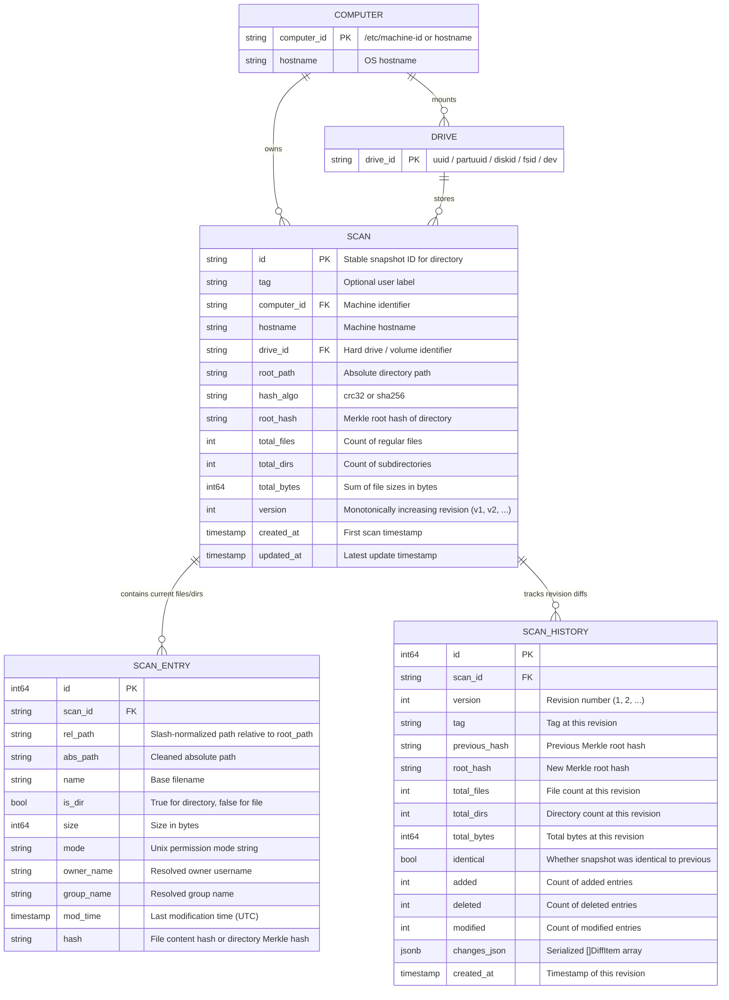

# Data Model & Storage Specification

This document details the domain structs in `pkg/models`, the relational PostgreSQL schema in `pkg/store/postgres.go`, the in-memory store representation in `pkg/store/memory.go`, and the JSON structures exchanged over the REST API.

---

## 1. Entity-Relationship Model

On the server, every scanned directory belongs to a **Computer** (`computer_id`, `hostname`) and a physical or logical **Drive / Volume** (`drive_id`). Re-scanning the same `(computer_id, drive_id, root_path)` updates the existing `scans` row in place (incrementing `version`), replaces its current `scan_entries`, and appends a new revision record to `scan_history`.

> [!NOTE]
> **Logical vs. Physical Entities:** In the ER diagram below, `COMPUTER` and `DRIVE` represent logical domain entities (`models.Computer` and its `drives` / `directories` (`models.ScanSummary`) slices, aggregated dynamically by `store.GroupScansByComputer`). Physically in PostgreSQL (`pkg/store/postgres.go`), all persistence is normalized across three tables: `scans`, `scan_entries`, and `scan_history`. In `scan_entries`, the SQL columns `owner_name` and `group_name` map directly to the Go struct fields `Owner` (`json:"owner"`) and `Group` (`json:"group"`) on `models.ScanEntry`.



---

## 2. Core Go Domain Types (`pkg/models`)

### `Computer` (`pkg/models/scan.go`)

Aggregates all tracked directories and hard drives belonging to a single machine:

```go
type Computer struct {
	ID          string        `json:"id"`
	Hostname    string        `json:"hostname"`
	Drives      []string      `json:"drives"`
	Directories []ScanSummary `json:"directories"`
	TotalFiles  int           `json:"total_files"`
	TotalDirs   int           `json:"total_dirs"`
	TotalBytes  int64         `json:"total_bytes"`
	UpdatedAt   time.Time     `json:"updated_at"`
}
```

### `ScanSummary`, `ScanEntry` & `ScanRecord` (`pkg/models/scan.go`)

Represents a tracked directory snapshot on a computer, its current file/directory entries, and its change history:

```go
type ScanSummary struct {
	ID         string    `json:"id"`
	Tag        string    `json:"tag,omitempty"`
	ComputerID string    `json:"computer_id"`
	Hostname   string    `json:"hostname"`
	DriveID    string    `json:"drive_id"`
	RootPath   string    `json:"root_path"`
	HashAlgo   string    `json:"hash_algo"`
	RootHash   string    `json:"root_hash"`
	TotalFiles int       `json:"total_files"`
	TotalDirs  int       `json:"total_dirs"`
	TotalBytes int64     `json:"total_bytes"`
	Version    int       `json:"version"`
	CreatedAt  time.Time `json:"created_at"`
	UpdatedAt  time.Time `json:"updated_at"`
}

type ScanEntry struct {
	RelPath string    `json:"rel_path"`
	AbsPath string    `json:"abs_path"`
	Name    string    `json:"name"`
	IsDir   bool      `json:"is_dir"`
	Size    int64     `json:"size"`
	Mode    string    `json:"mode"`
	Owner   string    `json:"owner"` // Stored as owner_name in PostgreSQL scan_entries
	Group   string    `json:"group"` // Stored as group_name in PostgreSQL scan_entries
	ModTime time.Time `json:"mod_time"`
	Hash    string    `json:"hash"`
}

type ScanRecord struct {
	ScanSummary
	Entries []ScanEntry        `json:"entries"`
	History []ScanHistoryEntry `json:"history,omitempty"`
}
```

### `ScanHistoryEntry`, `DiffItem`, `DiffReport` & `LiveEvent` (`pkg/models/scan.go`)

Captures each revision (`v1`, `v2`, ...) of a directory, full snapshot comparisons (`DiffReport`), and real-time `--live` filesystem change batches (`LiveEvent`):

```go
type ScanHistoryEntry struct {
	Version      int        `json:"version"`
	Tag          string     `json:"tag,omitempty"`
	PreviousHash string     `json:"previous_hash,omitempty"`
	RootHash     string     `json:"root_hash"`
	TotalFiles   int        `json:"total_files"`
	TotalDirs    int        `json:"total_dirs"`
	TotalBytes   int64      `json:"total_bytes"`
	Identical    bool       `json:"identical"`
	Added        int        `json:"added"`
	Deleted      int        `json:"deleted"`
	Modified     int        `json:"modified"`
	Changes      []DiffItem `json:"changes,omitempty"`
	CreatedAt    time.Time  `json:"created_at"`
}

type DiffItem struct {
	RelPath    string         `json:"rel_path"`
	Change     DiffChangeType `json:"change"` // "added", "deleted", "modified"
	IsDir      bool           `json:"is_dir"`
	BaseHash   string         `json:"base_hash,omitempty"`
	TargetHash string         `json:"target_hash,omitempty"`
	BaseSize   int64          `json:"base_size,omitempty"`
	TargetSize int64          `json:"target_size,omitempty"`
}

type DiffReport struct {
	BaseScan   ScanSummary `json:"base_scan"`
	TargetScan ScanSummary `json:"target_scan"`
	Identical  bool        `json:"identical"`
	Added      int         `json:"added"`
	Deleted    int         `json:"deleted"`
	Modified   int         `json:"modified"`
	Unchanged  int         `json:"unchanged"`
	Changes    []DiffItem  `json:"changes"`
}

type LiveEvent struct {
	Timestamp   time.Time  `json:"timestamp"`
	RootPath    string     `json:"root_path"`
	RootHash    string     `json:"root_hash"`
	Added       int        `json:"added"`
	Deleted     int        `json:"deleted"`
	Modified    int        `json:"modified"`
	Changes     []DiffItem `json:"changes"`
	ScanID      string     `json:"scan_id,omitempty"`
	ScanVersion int        `json:"scan_version,omitempty"`
}
```

### `DuplicateFileRef` & `DuplicateGroup` (`pkg/models/scan.go`)

Groups files across one or all stored snapshots that share identical non-empty content hashes and byte sizes:

```go
type DuplicateFileRef struct {
	ScanID     string `json:"scan_id"`
	ComputerID string `json:"computer_id,omitempty"`
	Hostname   string `json:"hostname"`
	DriveID    string `json:"drive_id,omitempty"`
	RootPath   string `json:"root_path"`
	RelPath    string `json:"rel_path"`
	AbsPath    string `json:"abs_path"`
}

type DuplicateGroup struct {
	Hash        string             `json:"hash"`
	Size        int64              `json:"size"`
	Count       int                `json:"count"`
	WastedBytes int64              `json:"wasted_bytes"`
	Files       []DuplicateFileRef `json:"files"`
}
```

---

## 3. PostgreSQL Schema (`pkg/store/postgres.go`)

```sql
CREATE TABLE IF NOT EXISTS scans (
	id TEXT PRIMARY KEY,
	tag TEXT NOT NULL DEFAULT '',
	computer_id TEXT NOT NULL DEFAULT '',
	hostname TEXT NOT NULL,
	drive_id TEXT NOT NULL DEFAULT 'default-drive',
	root_path TEXT NOT NULL,
	hash_algo TEXT NOT NULL,
	root_hash TEXT NOT NULL,
	total_files INTEGER NOT NULL,
	total_dirs INTEGER NOT NULL,
	total_bytes BIGINT NOT NULL,
	version INTEGER NOT NULL DEFAULT 1,
	created_at TIMESTAMPTZ NOT NULL,
	updated_at TIMESTAMPTZ NOT NULL DEFAULT NOW()
);

CREATE TABLE IF NOT EXISTS scan_entries (
	id BIGSERIAL PRIMARY KEY,
	scan_id TEXT NOT NULL REFERENCES scans(id) ON DELETE CASCADE,
	rel_path TEXT NOT NULL,
	abs_path TEXT NOT NULL,
	name TEXT NOT NULL,
	is_dir BOOLEAN NOT NULL,
	size BIGINT NOT NULL,
	mode TEXT NOT NULL,
	owner_name TEXT NOT NULL,
	group_name TEXT NOT NULL,
	mod_time TIMESTAMPTZ NOT NULL,
	hash TEXT NOT NULL
);

CREATE TABLE IF NOT EXISTS scan_history (
	id BIGSERIAL PRIMARY KEY,
	scan_id TEXT NOT NULL REFERENCES scans(id) ON DELETE CASCADE,
	version INTEGER NOT NULL,
	tag TEXT NOT NULL DEFAULT '',
	previous_hash TEXT NOT NULL DEFAULT '',
	root_hash TEXT NOT NULL,
	total_files INTEGER NOT NULL,
	total_dirs INTEGER NOT NULL,
	total_bytes BIGINT NOT NULL,
	identical BOOLEAN NOT NULL DEFAULT FALSE,
	added INTEGER NOT NULL DEFAULT 0,
	deleted INTEGER NOT NULL DEFAULT 0,
	modified INTEGER NOT NULL DEFAULT 0,
	changes_json JSONB NOT NULL DEFAULT '[]'::jsonb,
	created_at TIMESTAMPTZ NOT NULL
);

CREATE INDEX IF NOT EXISTS idx_scans_computer_dir ON scans(computer_id, drive_id, root_path);
CREATE INDEX IF NOT EXISTS idx_scan_entries_scan_id ON scan_entries(scan_id);
CREATE INDEX IF NOT EXISTS idx_scan_entries_hash ON scan_entries(hash);
CREATE INDEX IF NOT EXISTS idx_scan_history_scan_id ON scan_history(scan_id, version DESC);
```

---

## 4. Sample JSON Payloads

### `GET /api/v1/computers`

```json
[
  {
    "id": "8f3c1b2a9d4e5f60718293a4b5c6d7e8",
    "hostname": "workstation-01",
    "drives": [
      "uuid:d47a4e2e-8140-456d-83f2-09de0cb59b8b"
    ],
    "directories": [
      {
        "id": "scan-20261018-181000-a1b2c3d4",
        "tag": "live-watch",
        "computer_id": "8f3c1b2a9d4e5f60718293a4b5c6d7e8",
        "hostname": "workstation-01",
        "drive_id": "uuid:d47a4e2e-8140-456d-83f2-09de0cb59b8b",
        "root_path": "/home/user/workspace/project",
        "hash_algo": "crc32",
        "root_hash": "4557eab2",
        "total_files": 24,
        "total_dirs": 7,
        "total_bytes": 91420,
        "version": 2,
        "created_at": "2026-10-18T21:00:00Z",
        "updated_at": "2026-10-18T21:05:12Z"
      }
    ],
    "total_files": 24,
    "total_dirs": 7,
    "total_bytes": 91420,
    "updated_at": "2026-10-18T21:05:12Z"
  }
]
```
